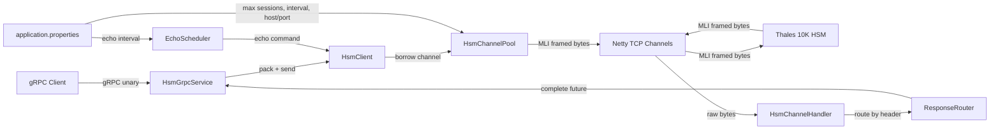

# Plan: CvHsm Gateway

## Goal

Build a Spring Boot 3.4 + Netty + gRPC Java gateway that receives gRPC requests, converts them into Thales 10K HSM host commands, sends them over persistent, reusable TCP sessions, matches responses by a unique 4-character correlation ID, and converts the HSM response back to a gRPC response. The gateway will also run an echo-test scheduler to keep all active sessions alive.

## Test Cases

> These will be saved to `.cursor/test-cases/cv-hsm-gateway.md` after the plan is confirmed.

### TC-1: gRPC request is packed and sent over an active HSM session

- **Type**: integration
- **Given**: A running gateway with at least one active TCP session to the HSM
- **When**: A gRPC client sends a supported HSM command request
- **Then**: The request is packed with the 4-char correlation header, 2-char command code, and body, prefixed with a 2-byte MLI header, and written to the session

### TC-2: HSM response is correlated and converted back to gRPC

- **Type**: integration
- **Given**: A pending gRPC request with a known correlation header
- **When**: The HSM returns a matching response (same 4-char header)
- **Then**: The response is unpacked, the error code is inspected, and the gRPC response is returned with the correct payload

### TC-3: Session pool honors the configured maximum session limit

- **Type**: unit/integration
- **Given**: `hsm.max-sessions` is set to N
- **When**: Multiple concurrent gRPC requests arrive
- **Then**: No more than N TCP channels are created, and channels are reused across requests

### TC-4: Disconnected session reconnects automatically

- **Type**: integration
- **Given**: A channel that is connected to the HSM
- **When**: The HSM closes the connection or the network drops
- **Then**: The gateway detects the disconnect, removes the bad channel, and lazily creates a new channel on the next request

### TC-5: Echo scheduler periodically sends echo commands on every active session

- **Type**: integration
- **Given**: The echo scheduler is enabled with a configured interval and there are M active sessions
- **When**: The scheduler fires
- **Then**: A B2 command is sent through each of the M sessions, the 4-hex length field is correct, the Data field contains a long numeric date/time value, and a successful B3 response keeps the session marked alive

### TC-6: A0 Generate Key command round-trip (Mode 1, ZPK export under ZMK)

- **Type**: integration
- **Given**: A valid gRPC Generate Key request with Mode = `1`, Key Type = `001` (ZPK), Key Scheme (LMK) = `U`, a ZMK value, and Key Scheme (ZMK) = `U`
- **When**: The gateway packs the A0 request and the HSM returns an A1 response with error code `00`
- **Then**: The gRPC response contains the generated key encrypted under the LMK, the generated key encrypted under the ZMK, and the 6-character key check value
- **Notes**: A0/A1 field structure is documented in `thm.pdf` page 39 (printed page number 39).

### TC-7: Duplicate correlation header collision handling

- **Type**: unit
- **Given**: A correlation header generator produces a value that is already in-flight
- **When**: A new request needs a header
- **Then**: The generator retries/resamples until a unique in-flight header is produced

### TC-8: HSM error response is surfaced as a gRPC error

- **Type**: integration
- **Given**: A request is sent and the HSM returns a response with a non-zero error code
- **When**: The response is unpacked
- **Then**: The gateway returns a gRPC error with a meaningful status code and the HSM error code in the description

### TC-9: Echo command Data field uses a long numeric date/time value

- **Type**: unit/integration
- **Given**: The echo scheduler or an explicit echo gRPC request is triggered
- **When**: The B2 request body is packed
- **Then**: The `Data` field is populated from a long numeric date/time representation (e.g., `YYYYMMDDHHMMSS` or epoch millis) and the 4-hex `Length` field matches the byte length of that data
- **Notes**: B2/B3 field structure is documented in `thm.pdf` page 438 (printed page number 438)

## Architecture Decisions

- **ADR-0001**: Use Netty for the TCP client — required by the user, naturally supports async I/O, persistent channels, and reconnect hooks.
- **ADR-0002**: Use the 4-char HSM header as the correlation ID — explicitly required by the user; uniqueness is enforced by the gateway.
- **ADR-0003**: Use gRPC unary RPCs — assumed for the first version because the requirements describe request/response matching, not streaming.
- **ADR-0004**: Use a fixed-size Netty channel pool with lazy reconnect — satisfies the requirement to reuse sessions and limit the maximum number of open connections.
- **ADR-0005**: Use Spring Boot Actuator and Log4j2 — required by the workspace Java standards.

## HSM Command Format Details

Based on `thm.pdf` (payShield 10K Core Host Commands, doc. PUGD0537-003).

### Wire Format

- MLI: 2 bytes, big-endian length of the HSM message that follows (excludes the 2-byte MLI itself).
- HSM message: 4-char message header (used as the gRPC/HSM correlation ID) + 2-char command code + body.
- Response: 4-char header (echoed) + 2-char response code + 2-char error code + body.

### Echo Test (B2 / B3)

- Command code: `B2`
- Response code: `B3`
- Request body:
  - `Length` (4 hex chars): length of the following Data field in bytes
  - `Data` (n bytes): raw data to be echoed
- Response body:
  - `Error Code` (2 chars)
  - `Data` (n bytes): echoed data
- The echo scheduler will fill `Data` with the current date/time encoded as a long integer (e.g., `YYYYMMDDHHMMSS` or epoch millis) and transmit it as the configured number of bytes.

### Generate Key (A0 / A1)

- Command code: `A0`
- Response code: `A1`
- Request body (selected fields for the first implementation):
  - `Mode` (1 hex char): `0` generate key, `1` generate key and encrypt under ZMK/TMK, etc.
  - `Key Type` (3 hex chars): key type code or `FFF` for Key Block LMK
  - `Key Scheme (LMK)` (1 char): scheme for encrypting the generated key under the LMK
  - Optional export section (delimiter `;`, ZMK/TMK flag, ZMK/TMK value, key scheme, Atalla variant, `%` delimiter, LMK identifier)
  - Optional key-block section (delimiter `#`, key usage, algorithm, mode of use, version, exportability, number of optional blocks, optional blocks)
- Response body:
  - `Error Code` (2 chars)
  - `Key (under LMK)` (variable length, depending on key scheme)
  - `Key (under ZMK/TMK)` (variable, only if Mode = `1` or `B`)
  - `Key Check Value` (6 hex chars)
  - `ZKA RNDI` (32 hex, only if ZKA Option = `1`)

For the initial gRPC mapping, the A0 command will support Mode `1` (generate key and encrypt under ZMK) with Key Type `001` (ZPK) and Key Scheme (LMK) `U`. The gRPC request will include the ZMK value and its scheme, and the response will return both the key under LMK and the key under ZMK plus the 6-character key check value.

## Architecture

### Data Flow

1. At startup, the gateway eagerly opens the configured number of TCP sessions to the HSM.
2. The gRPC service receives a request and validates it.
3. A unique 4-character correlation header is generated.
4. The appropriate `HsmCommand` implementation packs the HSM request body.
5. The request is prefixed with the 2-byte MLI length and sent over a Netty channel from the pool.
6. A `CompletableFuture` is registered in the `ResponseRouter` keyed by the correlation header.
7. The Netty inbound handler reads the MLI header, buffers the full HSM message, and forwards it to the router.
8. The router completes the future, the `HsmCommand` unpacks the body, and the gRPC response is returned.
9. If a channel disconnects, the pool marks it as failed and replaces it before the next request.

## Files to Create

- `pom.xml` — Spring Boot 3.4, Netty, gRPC (protobuf-maven-plugin), Log4j2, Lombok, JUnit 5.
- `src/main/resources/application.properties` — HSM host/port, max sessions, connect/read/write timeouts, echo interval, logging.
- `src/main/proto/hsm.proto` — gRPC service and message definitions for the supported HSM commands.
- `src/main/java/com/company/cvhsm/CvHsmApplication.java` — Spring Boot entry point.
- `src/main/java/com/company/cvhsm/config/HsmProperties.java` — typed configuration properties.
- `src/main/java/com/company/cvhsm/grpc/HsmGrpcService.java` — gRPC service implementation.
- `src/main/java/com/company/cvhsm/netty/HsmClient.java` — high-level TCP client facade.
- `src/main/java/com/company/cvhsm/netty/HsmChannelPool.java` — fixed-size channel pool with reconnect logic.
- `src/main/java/com/company/cvhsm/netty/HsmChannelHandler.java` — Netty inbound handler for MLI framing and response dispatch.
- `src/main/java/com/company/cvhsm/netty/HsmChannelInitializer.java` — Netty pipeline setup.
- `src/main/java/com/company/cvhsm/netty/MliEncoder.java` / `MliDecoder.java` — 2-byte MLI framing.
- `src/main/java/com/company/cvhsm/hsm/HsmRequest.java` / `HsmResponse.java` — HSM message models.
- `src/main/java/com/company/cvhsm/hsm/HsmCommand.java` — command packing/unpacking interface.
- `src/main/java/com/company/cvhsm/hsm/HsmCommandFactory.java` — resolves command implementations by code.
- `src/main/java/com/company/cvhsm/hsm/CorrelationIdGenerator.java` — unique 4-char header generator.
- `src/main/java/com/company/cvhsm/hsm/ResponseRouter.java` — in-flight request/response matching.
- `src/main/java/com/company/cvhsm/hsm/command/EchoCommand.java` — echo command implementation (page 438).
- `src/main/java/com/company/cvhsm/hsm/command/GenerateKeyA0Command.java` — A0 generate key implementation (page 39).
- `src/main/java/com/company/cvhsm/scheduler/EchoScheduler.java` — Spring `@Scheduled` keepalive.
- `src/main/java/com/company/cvhsm/exception/HsmException.java` / `HsmErrorCodeException.java` — domain exceptions.
- `src/test/java/...` — unit tests for framing, command packing, correlation, scheduler, and integration-style tests with an embedded Netty fake HSM.
- `.cursor/test-cases/cv-hsm-gateway.md` — derived test cases.
- `.cursor/adr/0001-netty-tcp-client.md`
- `.cursor/adr/0002-correlation-header.md`
- `.cursor/adr/0003-grpc-unary.md`
- `.cursor/adr/0004-channel-pool.md`
- `.cursor/adr/0005-actuator-log4j2.md`

## Tasks

1. [x] Bootstrap the Spring Boot project (`pom.xml`, `application.properties`, `.gitignore`, git init).
2. [x] Define the gRPC proto service and messages for the supported commands.
3. [x] Implement MLI framing encoder and decoder.
4. [x] Implement the Netty TCP client, eagerly establish the configured number of sessions at startup, and handle reconnect.
5. [x] Implement the response router with correlation-header matching and timeout handling.
6. [x] Implement the HSM message base model and `HsmCommand` framework.
7. [x] Implement the echo-test scheduler with a configurable interval.
8. [x] Implement the B2/B3 echo command with a 4-hex length field and a raw binary data payload.
9. [x] Implement the A0/A1 Generate Key command for Mode 1, Key Type 001 (ZPK), exporting under ZMK.
10. [ ] Write unit and integration tests for framing, pool, routing, scheduler, and both commands.
11. [ ] Add Spring Boot Actuator health endpoint and structured Log4j2 logging.
12. [ ] Create the ADRs and test-case file.
13. [ ] Verify the build and run the test suite.

## Risks

- **Correlation ID uniqueness** — A 4-char random string has a finite space. Mitigation: track in-flight IDs, resample on collision, and log a warning if collision frequency is high.
- **A0 command optional-field complexity** — The A0 command has many conditional delimiters and optional sections. Mitigation: build a small TLV/delimiter parser for the request/response body; for the first version support only Mode `1` with Key Type `001` (ZPK) exported under ZMK.
- **Reconnect during active request** — A request may be in flight when the connection drops. Mitigation: use request timeouts and fail the pending `CompletableFuture` with a clear gRPC error; do not retry HSM requests.
- **Session pool exhaustion** — All channels may be busy. Mitigation: configure a bounded wait time for channel acquisition and return a gRPC `UNAVAILABLE` status if the pool is exhausted.
- **HSM text/binary handling** — Most A0 fields are ASCII hex/numeric strings, while the B2 `Data` field is raw binary. Mitigation: treat command bodies as byte arrays; encode hex/numeric fields with ASCII and echo `Data` as raw bytes; make the charset configurable but default to ASCII.

## Decisions

The following open questions from the initial plan have been resolved:

1. **TCP connection establishment**: Eagerly at startup.
2. **gRPC/HSM timeout**: Configurable via `application.properties` with a sensible default (e.g., 5 seconds).
3. **gRPC service type**: Unary.
4. **HSM error handling**: Surface errors immediately to the gRPC caller; do not retry.
5. **A0 Generate Key scope**: Mode `1` (generate key and encrypt under ZMK), Key Type `001` (ZPK), Key Scheme (LMK) `U`, with ZMK and ZMK scheme provided in the gRPC request.
